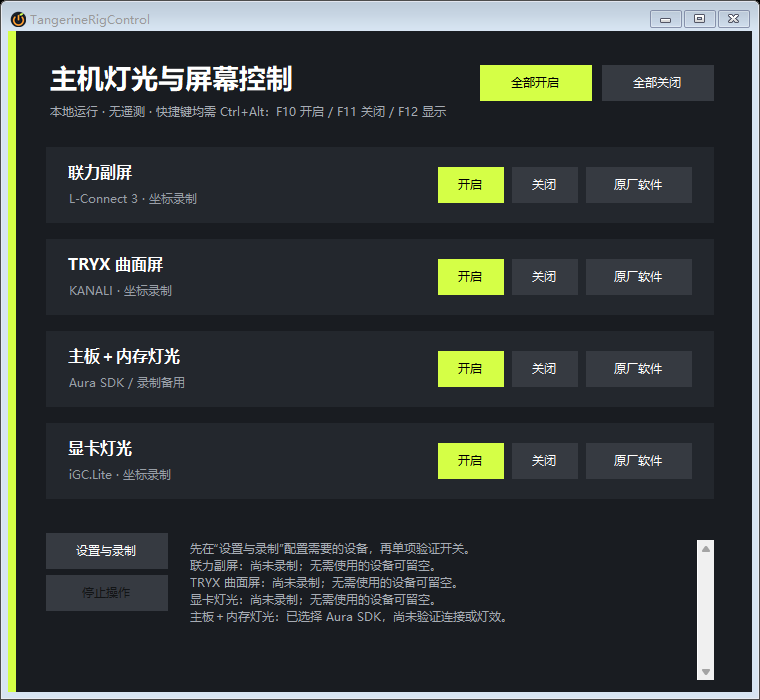

# TangerineRigControl

**在 Windows 托盘里，集中开关主机灯光和机箱屏幕。**

休息前想关掉机箱里的屏幕和灯光，却要分别打开几套原厂软件？TangerineRigControl 将 **L-Connect 3、TRYX KANALI、iGC.Lite 和华硕 Aura** 的常用开关集中到一处。完成配置后，可以单独操作设备，也可以从托盘或快捷键依次执行全部开关。

[下载预览版](#下载与运行) · [适配范围](#适合哪些设备) · [首次使用](#第一次使用) · [使用与排错](docs/USAGE.md) · [反馈问题](https://github.com/Manamiiii/TangerineRigControl/issues/new/choose)

- **少找几个窗口**：主界面、托盘菜单、全局快捷键，都能发起日常开关。
- **只配置需要的设备**：逐项使用或依次执行全部操作，不必凑齐四类硬件。
- **本地使用，免安装**：解压后运行，无需应用账户，无遥测；配置保存在本机。源码以 [GPL v3](LICENSE) 分享。

> **预览版 · 中文界面 · Windows 10/11**。适合已经使用上述原厂软件、愿意录制和校准开关步骤的用户。它不会自动识别所有硬件；原厂软件更新或布局改变后，可能需要重新校准。具体设备与软件版本需要实测。

*当前程序的真实界面，以空白合成配置渲染；图中的 SDK 选项不代表已连接设备。*

## 适合哪些设备

| 设备/软件 | 控制方式 | 使用前需要什么 |
| --- | --- | --- |
| 联力副屏 / L-Connect 3 | 回放录制的开关点击 | 安装原厂软件，分别录制开启和关闭 |
| TRYX 曲面屏 / KANALI | 回放录制的开关点击 | 安装原厂软件，分别录制开启和关闭 |
| 显卡灯光 / iGC.Lite | 回放录制的开关点击 | 选择原厂程序入口，分别录制开启和关闭 |
| 华硕主板、ARGB、内存 / Aura | 官方 Aura COM SDK，也可选录制备用 | 已安装可用的 Aura 服务与 COM 注册；实际支持设备需验证 |

软件通过原厂界面回放点击，或通过 Aura SDK 控制灯光。请保留对应原厂软件；目前的适配范围限于表中组合，不承诺任意品牌通用，也不操作风扇转速、电压或超频。

## 下载与运行

运行要求：Windows 10/11、**.NET Framework 4.8 或 4.8.1**，以及所需设备的原厂软件。先确认原厂软件能手动开关设备。缺少运行环境时参阅 [Microsoft 安装说明](https://learn.microsoft.com/en-us/dotnet/framework/install/)。普通用户不需要安装开发工具。

**目前通过 GitHub Actions 提供预览包，尚无 Release 发布包。** 下载 Actions 产物需要登录 GitHub，运行本工具不需要账户。

1. 打开 [Actions → build](https://github.com/Manamiiii/TangerineRigControl/actions/workflows/build.yml?query=branch%3Amain)，选择 **main 分支最近一次成功运行**。
2. 在该次运行页面底部的 **Artifacts** 中下载 `TangerineRigControl-windows-portable`。
3. 解压下载的外层 ZIP，再解压其中的 `TangerineRigControl-<版本>-windows-portable.zip` 到固定目录。运行里面的 **`TangerineRigControl.exe`**。
4. 进入“设置与录制”，按下面的步骤先完成一个设备。

找不到下载入口？确认已登录 GitHub、运行成功且产物未过期，参阅 [GitHub 下载说明](https://docs.github.com/en/actions/how-tos/manage-workflow-runs/download-workflow-artifacts?tool=webui)。也可以按 [开发说明](docs/DEVELOPMENT.md) 自行构建。仓库的 **Code → Download ZIP 是源码，不是可运行程序**；后续发布包会放在 [Releases](https://github.com/Manamiiii/TangerineRigControl/releases)。

便携包附带对应源码及 `.sha256` 校验文件，核对方法见 [下载校验](docs/USAGE.md#下载校验)。自动构建通过仅验证构建与自检，不代表已在你的硬件上验收。

程序当前未做代码签名。遇到 Windows 来源提示时先核对来源，不要关闭系统安全保护。

## 第一次使用

先让一个设备完成“关闭 → 开启”，再配置其他设备：

1. **选设备**：打开“设置与录制”，用“浏览…”选择对应原厂 `.exe`，再用“打开原厂软件”核对入口。不使用华硕 Aura 时，取消默认勾选的 SDK 选项；其余不用的项目保持空白。
2. **录制两个方向**：选择“录制开启”，在原厂软件的固定起始页面，把鼠标移到目标，按 **F8 记录坐标，再手动点击**。重复直到完成，点“保存序列”。单独录制关闭步骤。Aura SDK 模式不需要录制，使用前先看 [SDK 行为](docs/USAGE.md#aura-sdk-的特殊行为)。
3. **保存并验证**：还要点击设置页的 **保存**，再单项测试关闭、开启、重复关闭和重复开启。页面加载慢时，用序列旁的“等待…”调整；手动录制时的等待时长不会自动保存。

详细录制方法见 [录制、保存与调整等待](docs/USAGE.md#录制保存与调整等待)。确认各项表现正确后，再使用“全部”操作或启用登录启动。

**执行前保持相同的起始页面、布局和窗口大小，执行期间不要移动鼠标或切换窗口。** 坐标回放每步都会点击，不识别按钮状态；如果原厂控件只是“切换”，重复开启可能反而关闭，必须实测自己的序列。

| 快捷键 | 操作 |
| --- | --- |
| `Ctrl + Alt + F10` | 全部开启 |
| `Ctrl + Alt + F11` | 全部关闭 |
| `Ctrl + Alt + F12` | 显示控制台 |

关闭窗口或最小化会隐藏到托盘；真正退出请右键托盘图标选择“退出”。登录启动可在设置中开启，默认不启用，也不自动提权。

## 使用边界与常见问题

- **需要管理员权限吗？** 默认按普通权限运行。只有原厂软件以管理员运行且出现权限提示时，才退出控制台并以管理员身份重开。登录启动不会自动提权。
- **提示成功但设备没变化？** “序列已执行”仅表示点击已发出。检查起始页面、窗口尺寸、等待时间及原厂软件版本；不要连续盲目重试。
- **Aura 关灯后退出又亮了？** SDK 关闭通过写黑色并持有会话实现；开启或退出会释放控制权，恢复原厂默认灯效，不保证恢复自定义动画的精确状态。SDK 控制权切换可能影响其他 Aura 设备，其他灯控软件也可能抢回控制权。
- **停止能撤销吗？** 只能阻止后续步骤，已生效的操作不会撤销。SDK 超时停止等待也不等于底层调用已中断；出现“状态未知”时应查看原厂软件和硬件。
- **没有找到窗口、恢复失败、配置损坏？** 按 [排错表](docs/USAGE.md#出现问题时) 处理。配置恢复保护出现时不要清空或重录覆盖原文件。

全部操作顺序为联力 → TRYX → 显卡 → 华硕，未录制项目会提示跳过。更多窗口恢复和 SDK 行为见 [使用指南](docs/USAGE.md)。

## 数据、更新与反馈

配置保存在 `%LOCALAPPDATA%\TangerineRigControl\settings.xml`，正常保存保留上一次的 `.bak`。默认不写日志、不生成崩溃转储；原厂软件自身的联网和隐私行为由原厂决定。

更新前从托盘退出，备份配置目录，再替换程序；保留原安装位置可避免登录启动路径失效。卸载、备份恢复和详细隐私说明见 [使用指南](docs/USAGE.md#更新备份与卸载)。不要用他人的配置覆盖本机配置，路径与坐标无法通用。

反馈问题请使用 [Issues](https://github.com/Manamiiii/TangerineRigControl/issues)，附上错误文字、复现步骤、原厂软件版本及“设置与录制 → 复制脱敏诊断”。不要上传完整配置或未经检查的截图、原厂日志。

## 参与改进

欢迎通过 [设备兼容性反馈](https://github.com/Manamiiii/TangerineRigControl/issues/new?template=compatibility_report.md) 分享设备型号、原厂软件版本以及单次和重复操作的实际表现，成功和失败的结果都有帮助。可按 [设备验收清单](docs/NIGHTLY-DEVICE-TEST.md) 检查；遇到错误先看 [排错指南](docs/USAGE.md#出现问题时)。

开发者可阅读 [构建、自检与打包说明](docs/DEVELOPMENT.md)。项目采用 C# 5、WinForms 和 .NET Framework 4.8，保持本地、轻量的架构。

## License

Copyright (c) 2026 Manamiiii。

本项目采用 [GNU General Public License v3.0](LICENSE)，标识为 **GPL-3.0-only**（仅第 3 版）。你可以使用、修改和再分发，包括商业使用；分发受 GPL 覆盖的修改版时，需按 GPL v3 提供相应源码并保留相关声明。软件不提供担保，完整条款见许可证文件。

便携包的 `source/` 目录附带对应项目源码、资源与构建说明。重新分发修改后的程序时，请同时更新对应源码。

历史提交 [`6c2fa4e`](https://github.com/Manamiiii/TangerineRigControl/commit/6c2fa4e15804ca78c18fda8fa45992bca2059c69) 曾按 MIT 发布；本次切换不撤销该历史版本已经授予的 MIT 权利。

厂商软件和 SDK 遵循各自条款，不随本工具分发；本项目与所列厂商无隶属关系。
